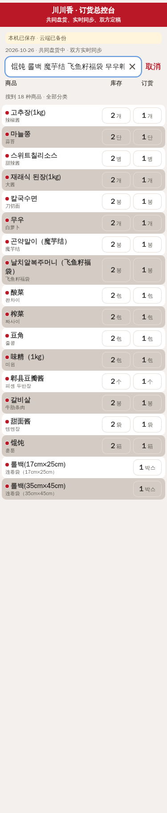
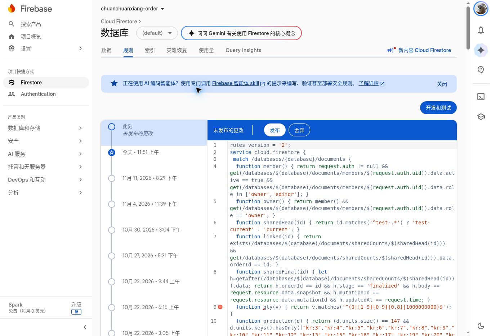

# v62 双语显示、米线库存单位与大号连卷袋

2026-11-15（韩国时间）。代码和完整测试已完成，**尚未正式发布**。Firebase控制台已登录，待发布规则已写入并核验，但自动审批拒绝生产环境“发布规则”操作，要求用户明确授权。main仍为v61；不能提前发布依赖147目录规则的网页。

## 用户要求与实现

- 中国食品米线 `cn:42 쌀국수`：新盘货库存单位단（捆），订货单位포대不变。不会按任意比例换算。
- 原有草稿空库存可采用新单位；明确重新输入库存时采用단。已有数值（包括0）、文字备注、已定稿/历史数据在查看或恢复时不改写。重新输入意味着用户按当前显示单位重新盘点。
- 其他商品新增 `other:24 롤백(35cm×45cm)`、单位박스，小字“连卷袋（35cm×45cm）”；原17×25cm商品仍独立存在。
- 总147：韩国51、中国76、其他15、饮料5。原146完整商品对象及相对顺序不变；`catalog-v146.json`保存旧目录。
- 共用`product-names.cjs`补齐遗漏翻译，并整理米线、魔芋结、飞鱼籽福袋的小字。主名称/原语言不变。两页、搜索结果和热搜沿用同一显示来源；旧快照也可展示补齐后的翻译，无需重写订单。
- 14个补充/整理条目见`tests/v62-translations.json`；147项均具有非空辅助名称。既有店内确认的译名保持，翻译表达仍可按实物包装进一步校准。
- 云端仅新增147目录形状、库存位置长度及草稿游标上限，保留129/137/138/142/144/146兼容。成员、权限、定稿、审计规则未放宽。

## 本次完整回归

[CI运行43720996664](https://github.com/q414994573/chuanchuanxiang-pandian/actions/runs/43720996664)，受测提交`b44339b6c27502f6e6a20920157605e0986192e9`：

- Node：16688/16688通过，失败/取消/跳过均0，较v61增加964项。
- 浏览器：Chromium 141.0.7390.37、WebKit26.0共30组4998/4998通过，失败0、页面错误0；受测源码指纹始终不变。
- 新增双语一致性浏览器套件：每引擎1824项，共3648项。147商品×3宽度×2角色×2状态逐项检查盘货/订单主副名称；附各分类完整性、页面横向溢出及全部数量/快照不变检查。
- 云端：六套模拟器工作流全部通过。七代目录×两角色，147商品盘货、保存、实时观察、定稿/解锁，新旧尺寸袋子独立数量与单位、米线库存단和订单포대检查通过。
- 三个CI作业日志均已读取，机器证据见`verification.json`。权限拒绝是负向用例的预期结果；仍有历史非法请求触发的1000表达式上限提示，不能写成零错误日志。
- 本地开发首轮出现26项旧显示/总数/边界期待失败，已按获授权的新规则更新断言；最终上述同一次完整CI全绿，不拼接旧结果。

图片为隔离测试数据，不是真实营业数量。未修改、删除或导出真实订单。没有以模拟器测试代替iPhone真机触感/系统分享等验证。

## 待发布与审批

规则编辑器内容与受测文件SHA256完全一致：`a69f4a8addb01ae2a5bb9d3c5c58e46d8fcb78ad81a3cd11a98b7b1df3abacbc`。正式旧规则SHA256：`9d61e20801d0d22c3f565055afe01cf4cb4223457231566bcd83b840eaa461f9`。

自动审批理由：点击Firebase生产环境“发布”会持久修改Firestore安全规则，需用户明确授权发布此规则到线上。尚未点击成功，界面仍为“未发布的更改”。用户批准后：重新确认编辑器哈希→发布→读回核验→合并受测代码及报告到main→核验Pages部署和线上文件哈希。不要重新请求密码，除非出现确切登录失效证据。

